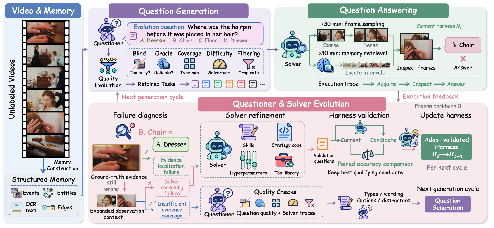

<div align="center">

# VideoEvoHarness

### Self Evolving Agent Harness from Unlabeled Videos for Video Understanding

[Overview](#overview) · [Installation](#installation) · [Inference](#inference) · [Evaluation](#evaluation) · [Harness Evolution](#harness-evolution)

</div>

## Overview

VideoEvoHarness improves video understanding using unlabeled videos. A
**Questioner** generates questions, a **Solver** answers them, and feedback guides
updates to prompts, retrieval strategies, hyperparameters and tools.

The process uses visual information only, without updating model weights or
requiring human-written question-answer annotations.

## Workflow

Turn videos into tasks, answer them, and use feedback to improve the harness
across rounds.

<p align="center">
  
</p>

1. **Build video memory.** Organize events, entities and visible text into searchable records.
2. **Generate and filter questions.** Derive questions and reference answers from memory, checking evidence dependence and answer reliability.
3. **Split the tasks.** Use one subset to diagnose failures and propose changes, and another to compare candidates.
4. **Answer and diagnose.** Use an overview for short videos, chunk reading for medium videos, and memory retrieval with replay for long videos. Identify missing evidence, insufficient evidence and reasoning errors.
5. **Improve the Solver.** Propose changes to prompts, strategies, parameters or tools. Compare them on the same validation questions and retain changes that pass accuracy and resource checks.
6. **Improve the Questioner.** Adjust the question policy to the updated Solver, generate tasks for the next round, and repeat.

## Installation

Prepare the environment, video plugins and model service. Use **Linux,
Python 3.10+**, with `ffmpeg` and `ffprobe` installed. Run all commands from
the repository root.

```bash
python3 -m venv .venv
source .venv/bin/activate
python3 -m pip install -r requirements.txt
cp qwen-mm-config.example qwen-mm-config
cp harness/data_split.example.json harness/data_split.json
```

Install [Qwen-MM-Plugins](https://github.com/QwenLM/Qwen-MM-Plugins) for video
reading and memory construction. Keep its source at `Qwen-MM-Plugins/` in the
repository root:

```bash
git clone https://github.com/QwenLM/Qwen-MM-Plugins Qwen-MM-Plugins
python3 -m pip install -e "./Qwen-MM-Plugins[video-memory]"
```

Fill in `qwen-mm-config`:

| Setting | Value |
|---|---|
| `DASHSCOPE_BASE_URL` | API root, without `/chat/completions` |
| `DASHSCOPE_API_KEY` | API key |
| `QWEN_MM_API_VL_MODEL` | Model name |
| `LLM_PROVIDER` | `qwen`, `gemini` or `doubao` |

Follow the [embedding service instructions](embedding_server/README.md) to
configure Qwen3-Embedding-8B and your upstream model endpoint, then start the
local service. The example API root is `http://127.0.0.1:8901/standard/v1`.

## Inference

**Purpose: answer video questions with the current harness, without changing it.**

First [prepare video memory](#1-prepare-video-memory) under `memory/video001/`.
Then save questions in `data/questions.jsonl`, one object per line:

```json
{"qid":"q1","video_key":"video001","type":"object_recognition","question":"What is the person holding?","options":["A. A cup","B. A book","C. A phone","D. A bag"],"n_options":4,"answer":"A","anchor":null}
```

`video_key` identifies the memory directory. `answer` is the reference for scoring;
use `""` when no reference is available and inspect predictions only.

```bash
mkdir -p outputs/inference
python3 harness/solve.py \
  --questions data/questions.jsonl \
  --out outputs/inference/results.json \
  --workers 4
```

Results are saved to `outputs/inference/results.json`; `pred` in each record is
the predicted answer.

## Evaluation

**Purpose: measure the current harness's answer accuracy on public video-QA datasets.**

Prepare benchmark data, videos and matching memories. Save the current harness
version, then run evaluation:

```bash
python3 harness/state_bundle.py snapshot --dest bundles/current
python3 harness/benchmark_audit.py run \
  --benchmarks longvideobench,mmvu,video_holmes \
  --benchmark-root benchmarks --memory-root memory \
  --state-bundle bundles/current --run-dir outputs/evaluation
```

This example evaluates multiple-choice questions with available video memory.
Answers are saved under `outputs/evaluation/results/`; accuracy and coverage
are reported in `outputs/evaluation/summary.json`.

## Harness Evolution

**Purpose: use unlabeled videos to generate tasks, diagnose errors and update
the harness, improving its question-answering ability across rounds.**

### 1. Prepare video memory

Turn videos into searchable records for question generation and answering.
For one video:

```bash
bash Qwen-MM-Plugins/src/capabilities/video-memory/skill/script/build_memory/build_memory.sh \
  /path/to/unlabeled/video001.mp4 --output-dir memory/video001 \
  --no-asr --p2-workers 2
python3 harness/enrich_memory.py --videos video001 --workers 4
```

Repeat for the other videos. In `harness/data_split.json`, set
`evolve_source.videos` to the memory directory names, such as
`["video001", "video002"]`. List evaluation videos in `video_ids` or
`bench_ids_path` to keep the two groups separate.

### 2. Generate and filter questions

Create questions and reference answers from video memory, then filter and score
them to form the evolution and validation question bank.

```bash
python3 harness/ask.py --n 600
python3 harness/verify.py --workers 4
python3 harness/qscore.py
```

Questions are saved under `harness/store/`, with the quality report at
`harness/store/runs/qscore.json`. Both evolution and validation subsets need questions.

### 3. Run the evolution loop

Use the question bank to diagnose errors, propose and validate changes, then
update how the harness answers and generates questions.

```bash
VEH_EXTERNAL_JUDGE=off python3 harness/loop.py \
  --rounds 1 --skip-build --workers 4
```

Increase `--rounds` for more iterations. Accepted changes update the harness
configuration, prompts, strategies and tools. Run records stay in `harness/store/`.

## Acknowledgements

We thank the Qwen team for open-sourcing
[Qwen-MM-Plugins](https://github.com/QwenLM/Qwen-MM-Plugins), which provides
video-reading and video-memory infrastructure for this project.

## License

This project uses the [MIT License](LICENSE). Qwen-MM-Plugins uses
[Apache License 2.0](https://github.com/QwenLM/Qwen-MM-Plugins/blob/main/LICENSE).
